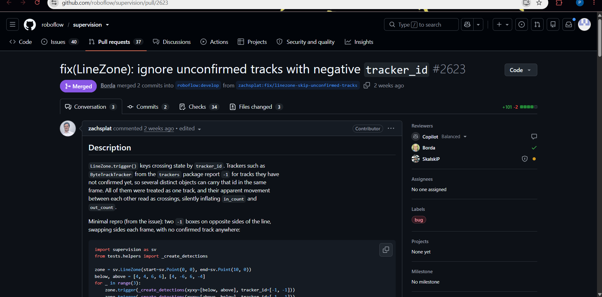
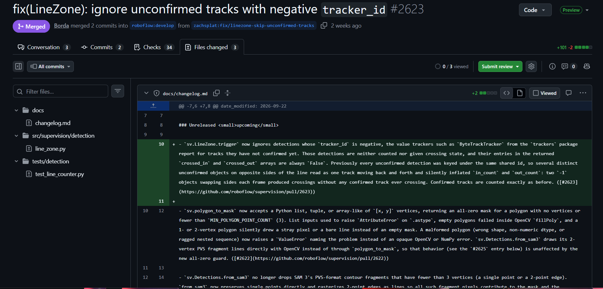
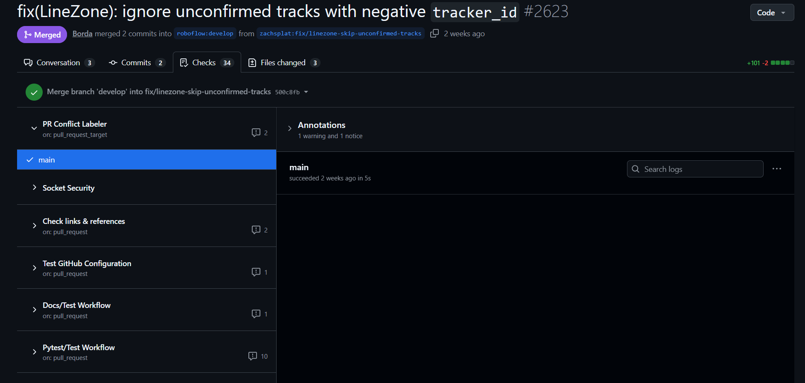
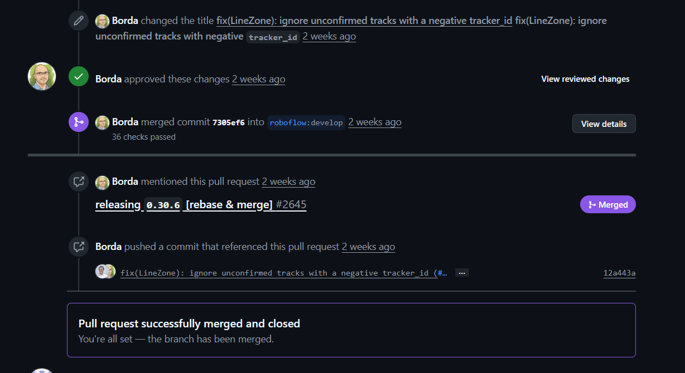
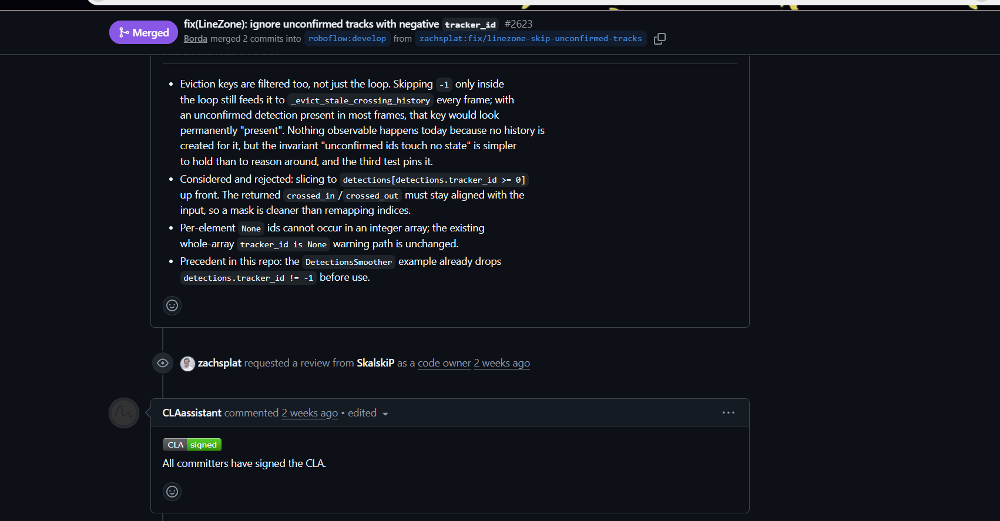

# Pull Request Analysis: PR #2623

## 1. Overview

**Pull request:** [#2623 — fix(LineZone): ignore unconfirmed tracks with negative tracker_id](https://github.com/roboflow/supervision/pull/2623)

| Field | Details |
|---|---|
| Project | Roboflow Supervision |
| Pull request author | zachsplat |
| Target branch | `develop` |
| Label | `bug` |
| Final status | Merged |
| Related issue | [#2578](https://github.com/roboflow/supervision/issues/2578) |

## 2. Problem and Motivation

The change addresses how `LineZone` handles unconfirmed tracks with a negative `tracker_id`. The goal is to prevent unconfirmed tracks from being treated as valid tracked objects.

This is a targeted bug fix in the line-zone detection functionality.

## 3. Code Changes

The pull request changes were reported in these areas:

- `src/supervision/detection/line_zone.py` — implementation of the fix.
- `tests/detection/test_line_counter.py` — tests covering the relevant behavior.
- `docs/changelog.md` — documentation of the change in the changelog.

The implementation change and its tests are important together: the code addresses the reported behavior, while regression tests help ensure it continues to behave correctly.

## 4. Testing and Continuous Integration

The pull request's Checks tab displayed multiple automated checks. The investigation screenshot showed 34 checks in the Checks tab, while the merge timeline reported 36 checks passed. These are the counts displayed in the respective views.

Automated checks help detect failures before a pull request is merged. The project also uses workflows for testing, documentation, link checking, and repository configuration.

## 5. Review and Approval

The pull request showed automated review feedback from Copilot and a human approval from Borda. A code-owner review request was also visible for SkalskiP.

The pull request was subsequently merged into `develop`.

This illustrates how automated feedback, human review, and repository ownership can contribute to the review process.

## 6. Contributor Licence Agreement

The pull request displayed a CLA Assistant message confirming that all committers had signed the Contributor License Agreement.

A CLA check helps a project verify that contributors have completed the required contribution agreement process.

## 7. Related Issue and Competing Work

Issue [#2578](https://github.com/roboflow/supervision/issues/2578) is associated with the bug being addressed. The investigation also identified related competing work in PR #2579.

Related issues and pull requests help reviewers understand the original report, avoid duplicate fixes, and follow the history of a change.

## 8. Key Findings

1. The change is a focused bug fix rather than a large feature addition.
2. Implementation changes are accompanied by regression tests and a changelog update.
3. Automated checks provide evidence about build and test status.
4. Human review and code-owner involvement support maintainability.
5. CLA completion is part of the contribution process.
6. The pull request was merged after review and successful checks.

## 9. Evidence and Limitations

This analysis is based on the pull request overview, Checks tab, review timeline, and CLA screenshot captured during the investigation. Check counts can differ between views, and pull request status or displayed checks may change over time.

