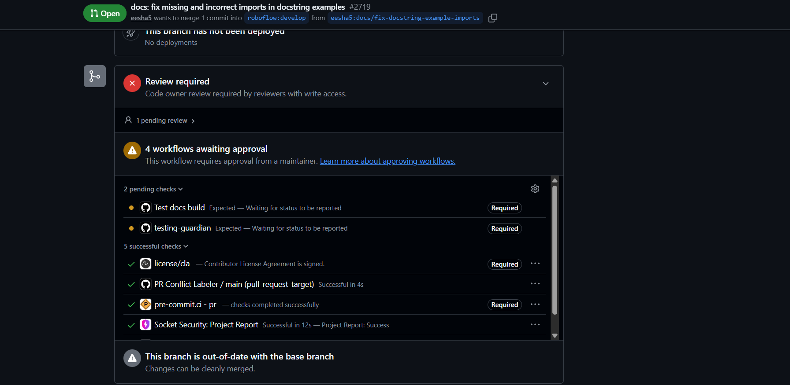

# Live Pull Request Example: PR #2719

## 1. Overview

**Pull request:** [#2719 — docs: fix missing and incorrect imports in docstring examples](https://github.com/roboflow/supervision/pull/2719)

| Field | Details |
|---|---|
| Project | Roboflow Supervision |
| Target branch | `develop` |
| Change type | Documentation fix |
| Status in captured screenshot | Open; review and checks still in progress |

## 2. Purpose of the Change

The pull request aims to correct missing or incorrect imports in documentation examples embedded in docstrings.

Correct imports matter because documentation examples should be understandable and usable by developers following the library's API.

## 3. Checks Observed

At the time of the screenshot, the Checks section showed:

- CLA signing completed.
- `pre-commit.ci` passed.
- Socket Security passed.
- Four workflows were awaiting maintainer approval.
- The documentation build and `testing-guardian` checks were still pending.
- The code-owner review was pending.
- The branch was reported as out of date with the base branch.

These observations describe the captured screenshot, not necessarily the pull request's current status.

## 4. What This Demonstrates

This example shows that a pull request may have some successful checks while other checks or approvals remain incomplete.

A passing check does not mean the entire pull request is ready to merge. Reviewers should also consider pending workflows, required approvals, and whether the branch needs updating.

## 5. Comparison with PR #2623

| Aspect | PR #2623 | PR #2719 at screenshot time |
|---|---|---|
| Change | LineZone bug fix | Documentation import fixes |
| Status | Merged | Open |
| CLA | Signed | Signed |
| Checks | Merge timeline reported successful checks | Some passed; others pending |
| Review | Human approval visible | Code-owner review pending |

## 6. Conclusion

PR #2719 provides a useful example of the checks and approvals contributors should monitor before merging. The final decision depends on the project's required checks, review requirements, and the state of the pull request at that time.
