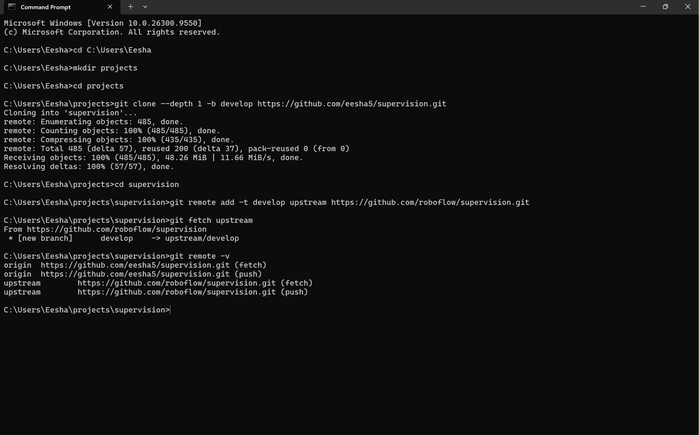
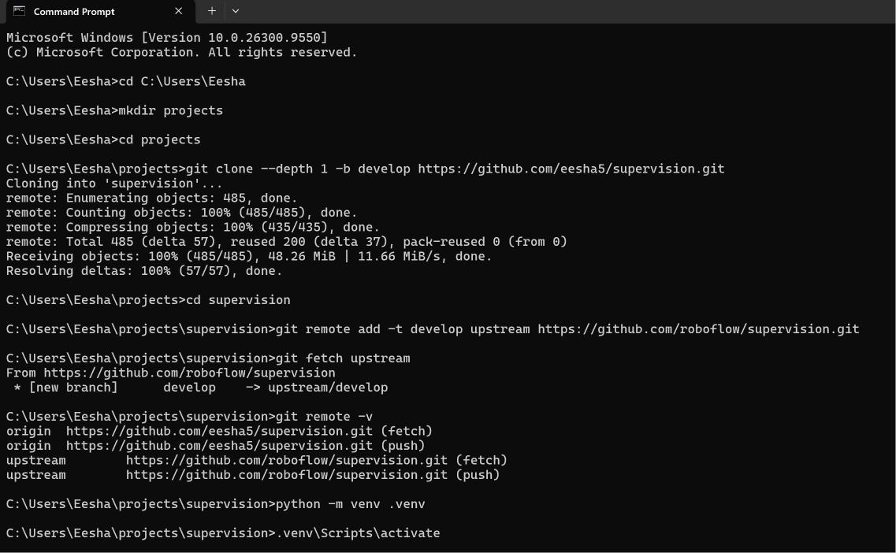
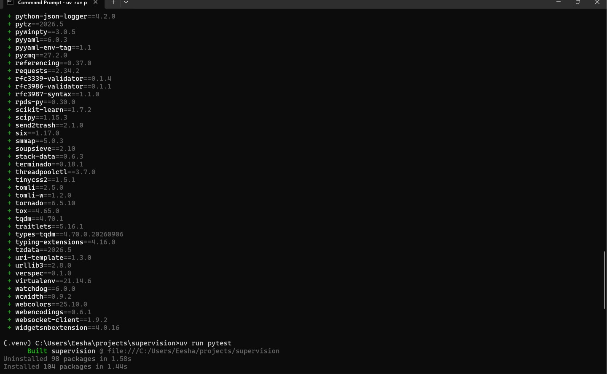
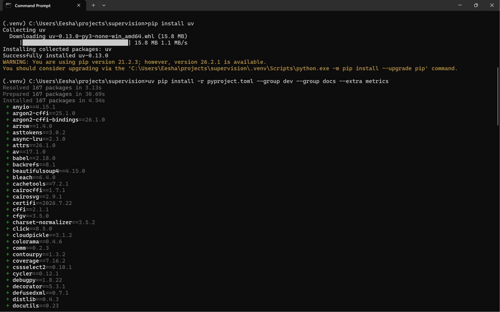
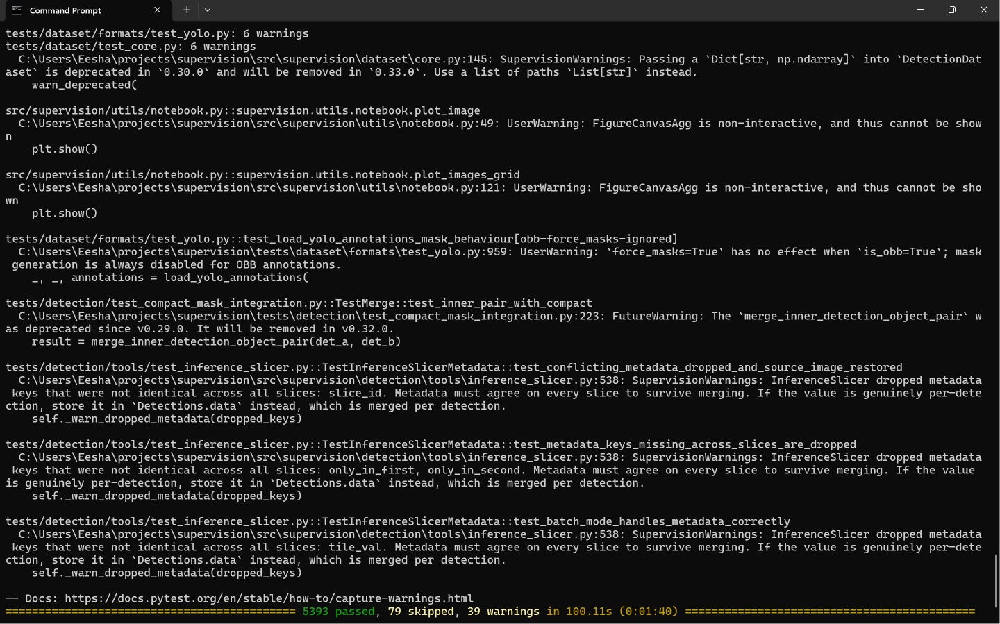

   # 1. Development Environment Setup

   | Item | Value |
   |---|---|
   | OS | Windows 11 (build 26300) |
   | Git | 2.55.0 |
   | Python | 3.10.0 |
   | uv | 0.13.0 |
   | Supervision branch | `develop`, forked to `eesha5/supervision` |

   ## Steps followed (from Supervision's CONTRIBUTING.md)

   1. Forked `roboflow/supervision` to `eesha5/supervision`
   2. Shallow-cloned the `develop` branch:
      `git clone --depth 1 -b develop https://github.com/eesha5/supervision.git`
   3. Added the original repo as the upstream remote:
      `git remote add -t develop upstream https://github.com/roboflow/supervision.git`
   4. Created and activated a virtual environment (`python -m venv .venv`)
   5. Installed `uv`, then the project dependencies (167 packages):
      `uv pip install -r pyproject.toml --group dev --group docs --extra metrics`
   6. Ran the full test suite with `uv run pytest`

   ## Result

   **5,393 passed, 79 skipped, 0 failed, 39 warnings in 100.11 s**

   
   
   
   
   

   ## Observations

   - `uv run` rebuilt Supervision from the local source and synced the environment to the project's locked dependency versions before running the tests.
   - The 39 warnings are deprecation notices raised on purpose by the test suite. They come from Supervision's deprecation policy, where old APIs stay for at least 3 minor releases before removal.
   - All tests passed on Windows, so the environment is ready for development.
