# 2. Our Contribution: Fixing Broken Docstring Examples

**Pull request:** [roboflow/supervision #2719](https://github.com/roboflow/supervision/pull/2719)
**Branch:** `docs/fix-docstring-example-imports` on [eesha5/supervision](https://github.com/eesha5/supervision)
**Status:** Open, CLA signed, awaiting maintainer review (code owner: SkalskiP)

## 2.1 Choosing what to work on

We first reviewed all open bug issues in Supervision. Every suitable one was already claimed:

| Issue | Status when checked |
|---|---|
| #2578 LineZone counts unconfirmed tracks as one object | Another contributor committed to opening a PR |
| #2598 LineZone flicker causes a false crossing | Maintainer offered it to the reporter and another user |
| #2524 PolygonZone occupancy | Assigned to another contributor |
| #2519 Pose augmentation cookbook | Already requested by another contributor |

Taking a claimed issue would be poor open-source etiquette and would likely end in a duplicate PR. Instead, we looked for an unreported problem. Supervision's CONTRIBUTING.md asks that docstring examples be correct and runnable, so we audited the examples that are written as fenced code blocks (these are not checked by the test suite).

## 2.2 The bug

We wrote a small script (`check_examples.py`) that parses each example and lists names that are used but never imported. It found **4 examples that fail with `NameError` if copied as written**:

| Function | Problem |
|---|---|
| `Classifications.from_clip` | uses `cv2.imread` without importing `cv2`; imports `PIL.Image` but never uses it |
| `Detections.from_tensorflow` | uses `sv.Detections` without `import supervision as sv` |
| `ConfusionMatrix.benchmark` | uses `np.ndarray` without `import numpy as np` |
| `IconAnnotator.annotate` | uses `np.random.choice` without `import numpy as np` |

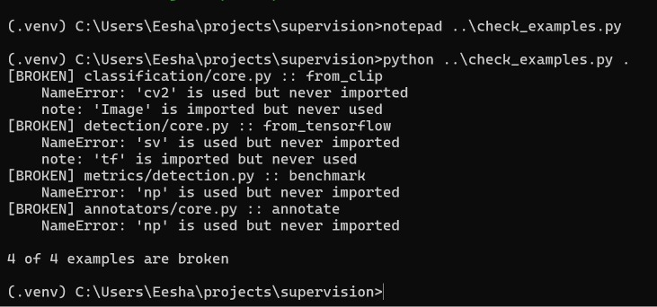

## 2.3 Checking for duplicate work

Before writing any code, we searched Supervision's pull requests for `from_clip`, `from_tensorflow` and `docstring import`. No open PR touched these examples.

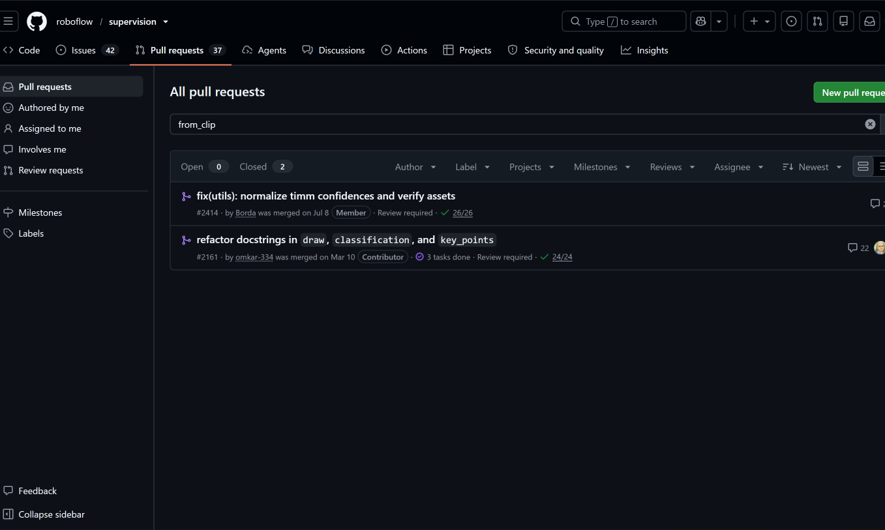
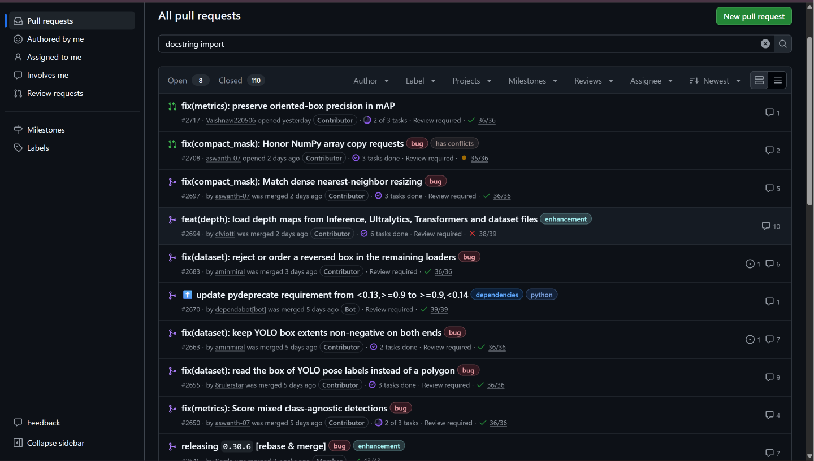
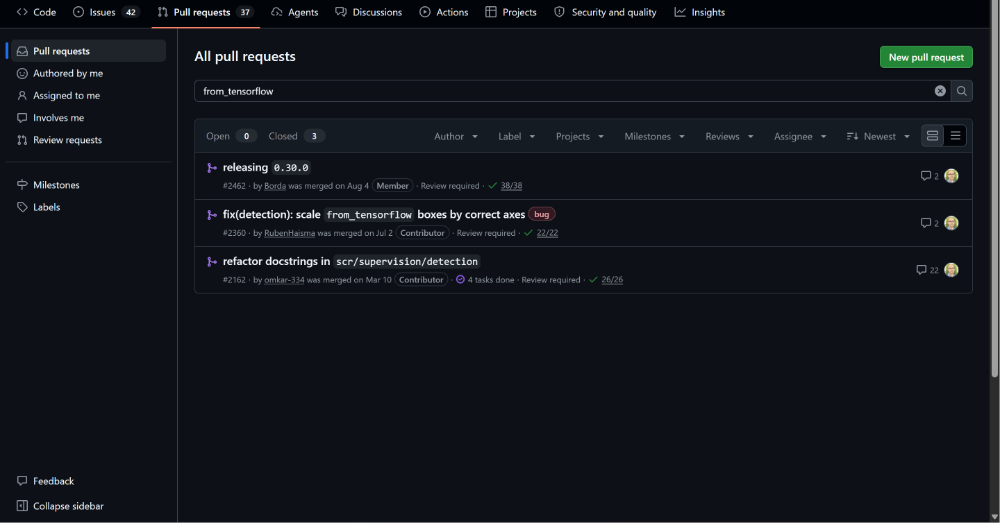

## 2.4 The fix

Branch created from the latest upstream code, following Supervision's `docs/` naming rule:

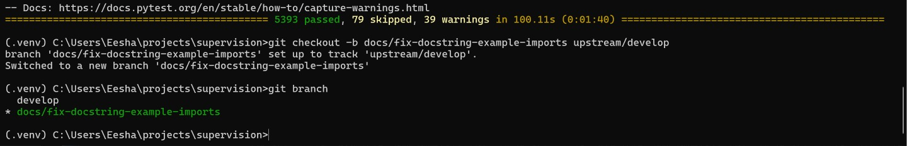

| File | Change |
|---|---|
| `classification/core.py` | `cv2.imread(...)` → `Image.open(...)`. CLIP's `preprocess` expects a PIL image, so this is the correct fix rather than adding a `cv2` import, and it also makes the existing `PIL` import used |
| `detection/core.py` | added `import supervision as sv` |
| `metrics/detection.py` | added `import numpy as np` |
| `annotators/core.py` | added `import numpy as np` |

Total: **4 files changed, 4 insertions, 1 deletion.** No library code was changed, only documentation examples.

Deliberately left out of scope: the unused `import tensorflow as tf` in the `from_tensorflow` example, since TensorFlow must be installed for `tensorflow_hub` anyway.

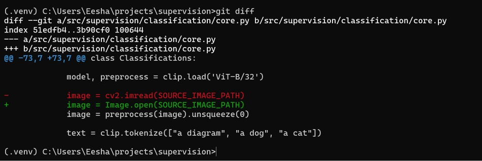
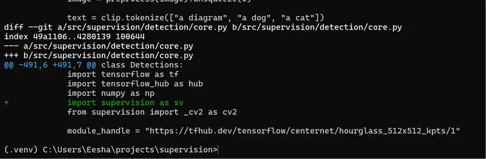
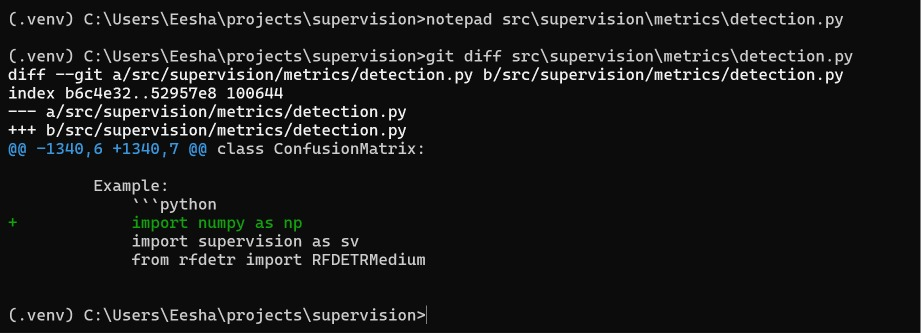
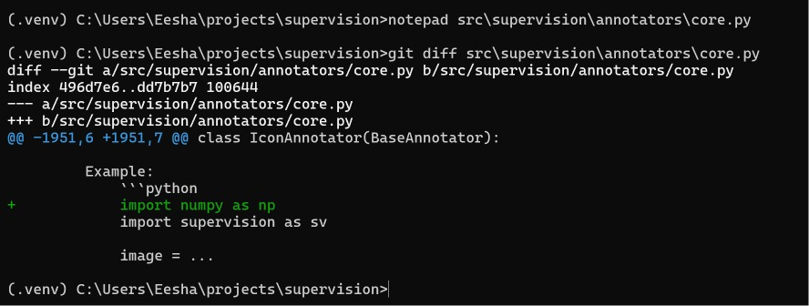

## 2.5 Testing

| Check | Result |
|---|---|
| `check_examples.py` after the fix | **0 of 4 broken** (was 4 of 4) |
| `pre-commit` (ruff, mypy, docformatter, codespell, etc.) | All passed |
| Full test suite `uv run pytest` | **5,393 passed, 79 skipped, 0 failed** (identical to before the change) |

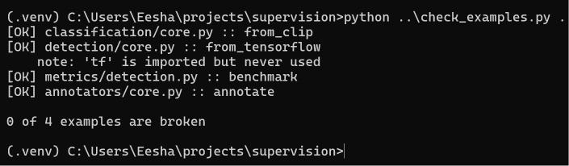
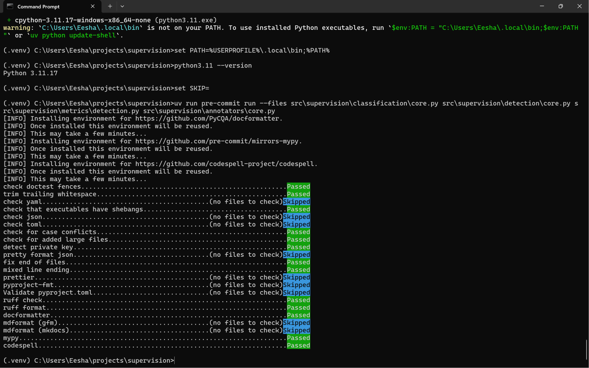
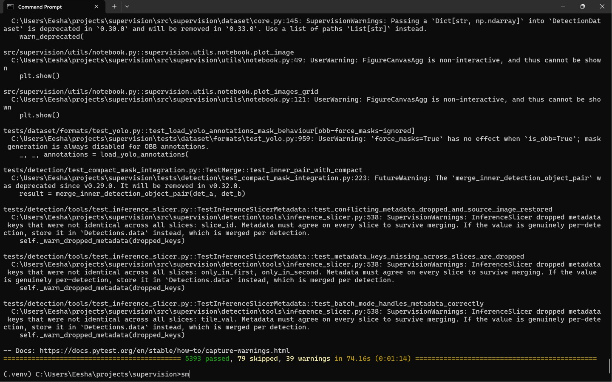

## 2.6 Commit and pull request

Commit message follows Supervision's conventional-commit rule:
`docs: fix missing and incorrect imports in docstring examples`

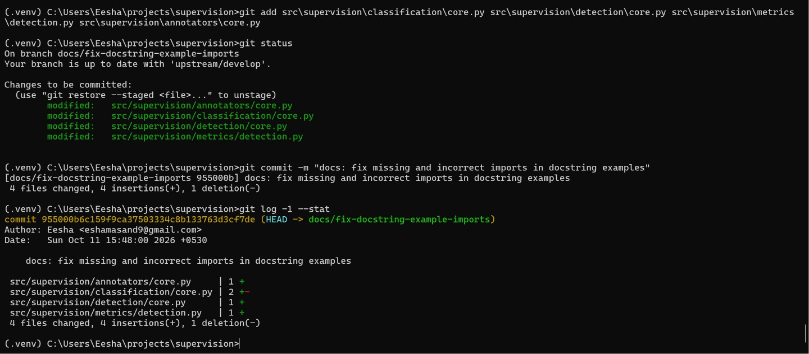
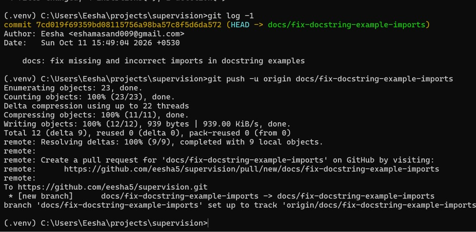

The PR description follows Supervision's own PR template (Description, Motivation, Changes Made, Testing, Additional Notes).

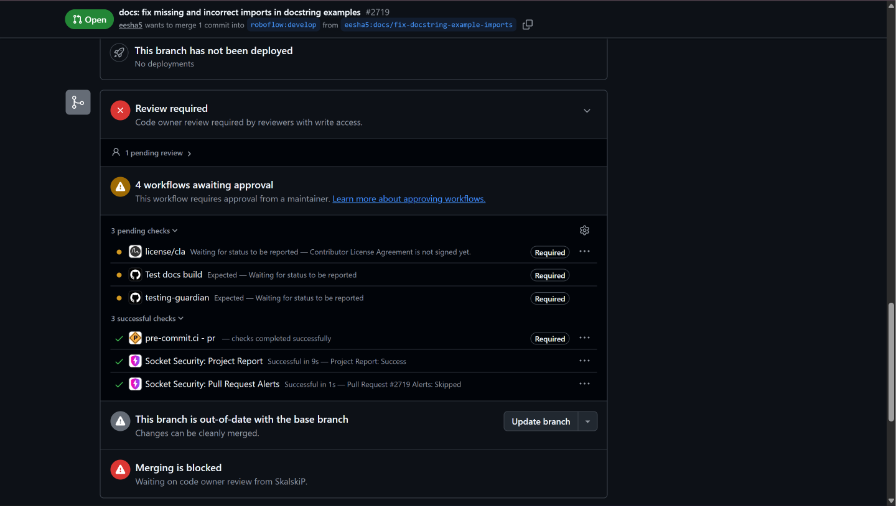
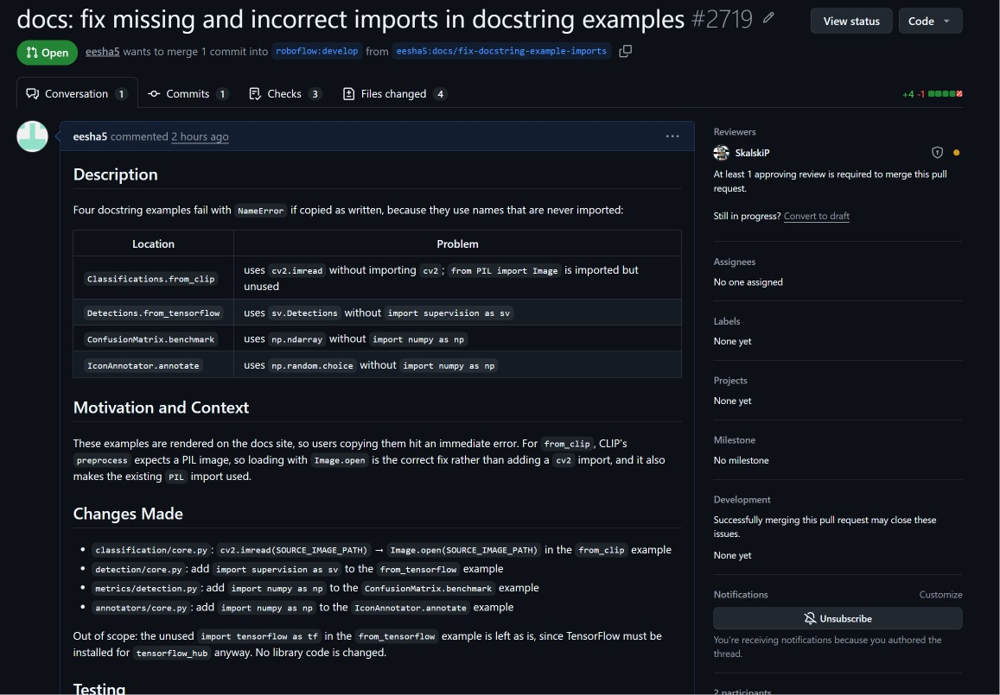

### PR checks after opening

| Check | Meaning | Status |
|---|---|---|
| pre-commit.ci | Code-quality checks on Supervision's servers | ✅ Passed |
| Socket Security | Automated dependency/security scan | ✅ Passed |
| license/cla | Contributor License Agreement | ✅ Signed |
| 4 workflows | Full CI test suite | ⏳ Needs maintainer approval (normal for first-time contributors) |
| Code owner review | SkalskiP must review | ⏳ Pending |

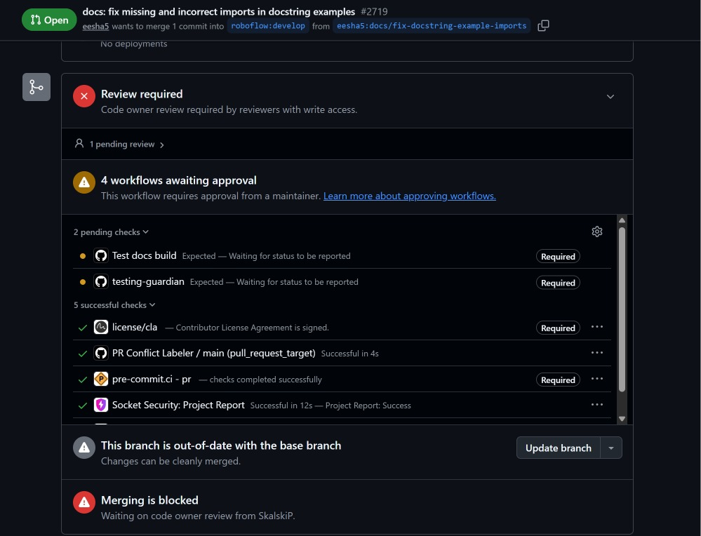

## 2.7 Practical observations

1. **Pre-commit needed Python 3.11.** Supervision's pre-commit hooks are pinned to Python 3.11, but our environment used 3.10. We installed 3.11 alongside it with `uv python install 3.11` to run the checks.
2. **The CLA is linked by commit email.** Our first push used an email not verified on the GitHub account, so the CLA bot could not identify the author. We amended the commit to use the verified email and force-pushed with `--force-with-lease` (which refuses to overwrite the branch if it has changed unexpectedly).
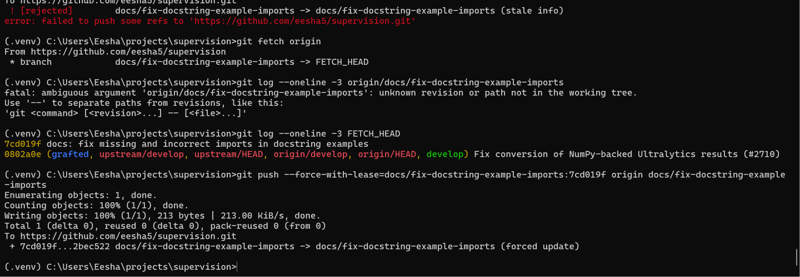
4. **Shallow clones lack remote branch info.** Because we cloned with `--depth 1 -b develop`, Git had no record of the PR branch's remote state, so `--force-with-lease` initially refused with "stale info". We fetched the branch and gave the expected commit explicitly.
5. **First-time contributors' CI needs approval.** GitHub does not run a project's workflows on a new contributor's PR until a maintainer approves them, which protects the project from untrusted code.
6. **Code owners.** Supervision's `CODEOWNERS` file automatically requested a review from SkalskiP, and merging is blocked until that review happens.

## 2.8 Use of AI assistance

An AI assistant helped audit the docstring examples and guided the workflow. Every change was made, verified and submitted by us, and this is disclosed in the PR description.
